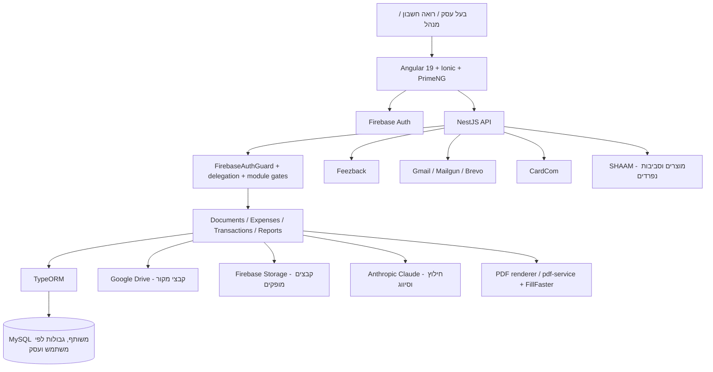
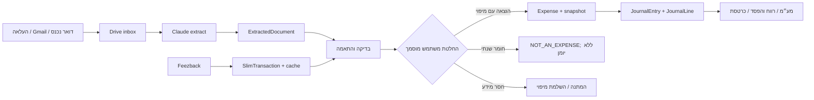
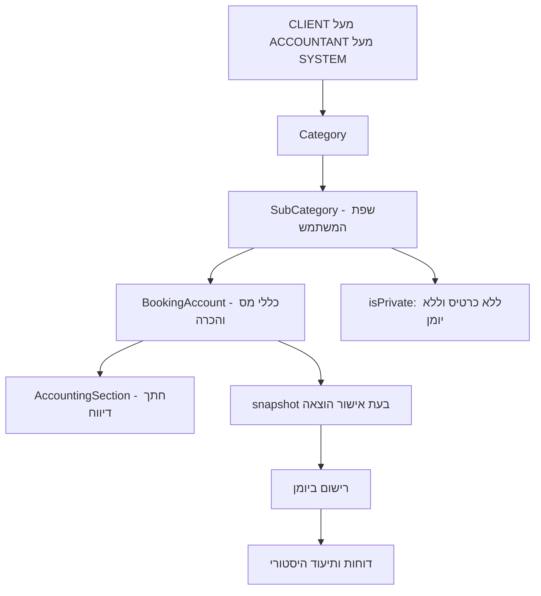
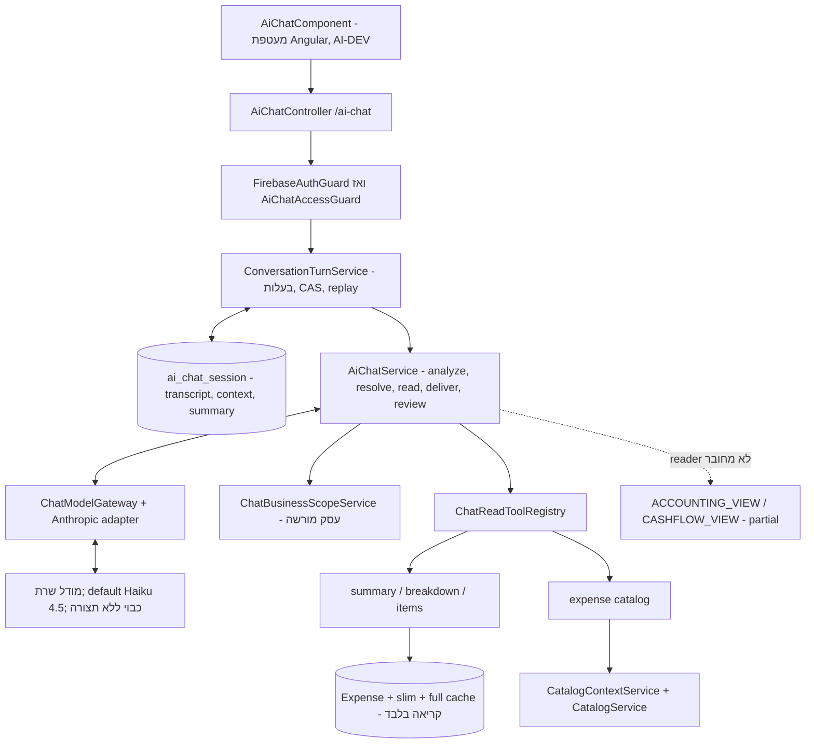

# תרשימי ארכיטקטורה

התרשימים מתארים גבולות לוגיים בקוד; הם אינם תרשים פריסה מאומת של production.

## תמונת מערכת ב־MAIN

מקורות: `backend/src/app.module.ts`, `frontend/package.json`, תיקיות `backend/src/documents/`, `backend/src/integrations/`, `backend/src/shaam/`.

## קליטה ואישור

הוצאה ויומן נשמרים יחד במסלולי האישור; החצים אינם מציינים שכל קליטת המקור מתבצעת באותה טרנזקציה. מקורות: `backend/src/reports/report-review.service.ts`, `backend/src/expenses/expenses.service.ts`.

## כללי סיווג לעומת היסטוריה חשבונאית

שינוי מיפוי לעתיד אינו בקשה לשכתב הוצאות קודמות. תווית וחתך בדוח עדיין עשויים להיקרא מקטלוג כרטיסים נוכחי; יש להבחין בינם לבין הסכומים שנרשמו. מקורות: `backend/src/bookkeeping/catalog.service.ts`, `backend/src/expenses/expenses.service.ts`, `backend/src/reports/reports.service.ts`.

## תוספת AI-DEV — הצ׳אט בפיתוח

התרשימים הקודמים משמרים את MAIN. התרשים הבא מתאר קוד ב־worktree `C:/Users/user/Keepintax/TaxMyself-new-ai-chat`, ענף `new-ai-chat`, commit `8c30a975142816ffafcb99f672786223d1044b92`; אינו חלק מ־MAIN שנבדק ואינו טענת פריסה.

השיחה קוראת נתונים עסקיים וכותבת state רק בטבלת session; אין כלי אישור הוצאה או כתיבה ליומן. context רגיל מורשה לפי בעלות/ייצוג; client-view רגיל חסום ואילו admin client-view מוגבל לעסקי הלקוח הנצפה. מקור AI-DEV: `backend/src/ai-chat/`, `frontend/src/app/components/ai-chat/`, `frontend/src/app/services/ai-chat.service.ts`. פירוט: [מפת פיתוח AI Chat](../06-ai/development-ai-chat.md).
