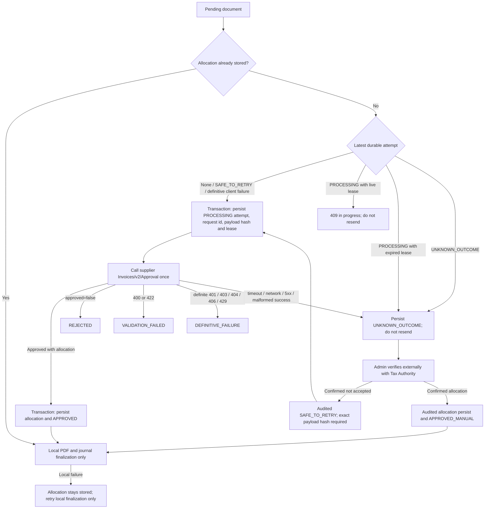

# SHAAM invoice-allocation state machine

## Official API boundary

Keepintax requests a supplier allocation through `Invoices/v2/Approval` using
the supplier-authorized OAuth connection. The Tax Authority's
`Invoice-Information/confirmationNumber` and `details` operations belong to
the customer-side Invoice Information flow and require authorization for the
customer VAT number. They are not a supplier-side recovery mechanism and are
never called by this allocation workflow.

The public guidance requires a stable, unique `INVOICE_ID`, but does not
document a general safe replay guarantee after a timeout. An ambiguous
Approval outcome is therefore never sent again automatically.

Official reference: Israel Tax Authority, *Israel Invoices API v2 software
houses guidance*, chapters 2 and 3:
<https://www.gov.il/BlobFolder/generalpage/hor-software-other/he/vat_software-houses-180724.pdf>.

## Flow

## State and operator rules

| State | Meaning | Automatic action |
|---|---|---|
| `PROCESSING` | Approval call has a live lease | Wait; never send again |
| `APPROVED` | Allocation and attempt were saved atomically | Complete local finalization |
| `REJECTED` | Provider explicitly did not approve | Show rejection; no automatic retry |
| `VALIDATION_FAILED` | Deterministic request validation failure | Correct through a controlled product flow |
| `DEFINITIVE_FAILURE` | Provider rejected before a successful allocation response | A later exact-document retry is allowed |
| `UNKNOWN_OUTCOME` | The provider may have accepted the invoice | Block replay and finalization without an allocation |
| `SAFE_TO_RETRY` | Admin recorded external evidence that it was not accepted | Permit one new exact-document attempt |
| `APPROVED_MANUAL` | Admin recorded an externally verified allocation | Complete local finalization only |

The admin must verify through an authoritative Tax Authority channel, not
infer acceptance from an HTTP status. Evidence is a bounded reference ID, not
free text. The official guidance lists software-house support at
`ApiSupport@taxes.gov.il`.

## Logging contract

Transition logs contain only stage, opaque request/attempt IDs, old/new state,
environment, bounded HTTP status and a safe failure category/code. They exclude
tokens, bodies, VAT/business/customer numbers, document references,
allocation numbers, dates and amounts.
